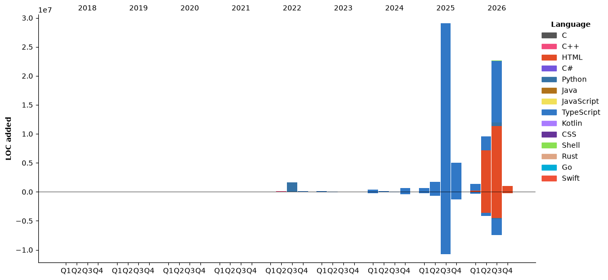

<h1 align="center">Nelson Lai</h1>

<p align="center">
  <strong>Full-stack developer</strong> · Melbourne, Australia
  <br/>
  Building modern web applications and open-source tools, end to end.
</p>

<p align="center">
  <a href="https://www.lst97.dev"></a>
  <a href="https://www.linkedin.com/in/lst97"></a>
  <a href="mailto:laisiotou1997@gmail.com"></a>
  <a href="https://status.lst97.dev"></a>
</p>

## About

I'm a full-stack developer based in Melbourne, Australia, originally from Hong Kong. I build products end to end — interface, API, database and deployment — and publish the tools I use myself as open source.

My working stack is TypeScript, React and TanStack Start on the front end, with back-end work in C# and PostgreSQL. I graduated with a Bachelor of Computer Science from Deakin University in 2023, and I'm most interested in system architecture, developer tooling and pragmatic AI-assisted workflows. Larger projects live under the [lst97-oss](https://github.com/lst97-oss) organisation.

## Selected work

| Project | What it is | Stack |
| :--- | :--- | :--- |
| **[LAST//OS](https://www.lst97.dev)** | The desktop-styled site behind lst97.dev: Payload CMS, a retrieval-augmented assistant over my GitHub and WakaTime data, and a structured contact workflow. | TypeScript, Bun, TanStack Start, React 19 |
| **[last-comments](https://last-comments.lst97.dev)** | Self-hosted comment system for any page: moderation, site-scoped API keys, a plugin pipeline, and drop-in widgets for React, Vue, Angular and plain HTML. | TypeScript, Payload, TanStack Start |
| **[Canto101](https://www.lst97.dev/projects/canton-101)** | Cantonese learning platform on a curated lexical corpus: dictionary lookup, word-level karaoke timing, talk lessons and a graded practice loop. | Deno, Hono, Drizzle, PostgreSQL |
| **[G-NAF Address Autocomplete](https://gnaf.lst97.dev)** | Self-hosted Australian address search over about 16 million G-NAF addresses, under 50 ms p95 on PostgreSQL indexes alone. | TypeScript, Bun, Elysia |
| **[Best Maker](https://www.bestmaker.com.au)** | Quote-to-cash platform for a custom fabrication and joinery business: split payments, bank reconciliation and a commerce back office. | Next.js, Payload, TanStack Query, Tailwind CSS |
| **[claude-code-sub-agents](https://github.com/lst97/claude-code-sub-agents)** | Collection of specialized AI subagents for Claude Code covering testing, code review, documentation and deployment. | Claude Code |

Smaller open-source work: [smartplay-hk-oss](https://github.com/lst97/smartplay-hk-oss) (Hong Kong public facility availability), [CantoCap](https://github.com/lst97/CantoCap) (Cantonese subtitle generation), [bin-time-crawler](https://github.com/lst97/bin-time-crawler) (Australian bin collection schedules), [info-hawker-server](https://github.com/lst97/info-hawker-server) (Australian open-data API) and [toonconv](https://github.com/lst97/toonconv) (TOON converter in Rust).

## Tech stack

- **Languages** — TypeScript, Python, Go, Rust, C#, Java, Kotlin, C/C++
- **Front end** — React 19, Next.js, TanStack Start, Vue, Angular, Tailwind CSS
- **Back end and data** — Bun, Deno, Node.js, Hono, Elysia, PostgreSQL, Drizzle ORM, Payload CMS, .NET
- **Delivery** — Docker, Linux, GitHub Actions, Vercel

## Currently

- Building [last-comments](https://www.lst97.dev/projects/last-comments) as a self-hosted alternative to hosted comment platforms.
- Working in TanStack Start, React 19 and Bun-first tooling.
- Writing about engineering with AI at [lst97.dev/blog](https://www.lst97.dev/blog).

## GitHub activity

<p align="center">
  <a href="https://github.com/lst97"></a>
  <a href="https://github.com/lst97"></a>
</p>
<p align="center">
  <a href="https://github.com/lst97"></a>
</p>

<details>
<summary><strong>WakaTime coding activity</strong> — refreshed daily</summary>

<!--START_SECTION:waka-->


**🐱 My GitHub Data** 

> 📦 412.4 kB Used in GitHub's Storage 
 > 
> 🏆 3,590 Contributions in the Year 2026
 > 
> 💼 Opted to Hire
 > 
> 📜 89 Public Repositories 
 > 
> 🔑 21 Private Repositories 
 > 
**I'm a Night 🦉** 

```text
🌞 Morning                180 commits         ░░░░░░░░░░░░░░░░░░░░░░░░░   01.48 % 
🌆 Daytime                3206 commits        ███████░░░░░░░░░░░░░░░░░░   26.38 % 
🌃 Evening                5635 commits        ████████████░░░░░░░░░░░░░   46.37 % 
🌙 Night                  3132 commits        ██████░░░░░░░░░░░░░░░░░░░   25.77 % 
```
📅 **I'm Most Productive on Sunday** 

```text
Monday                   1880 commits        ████░░░░░░░░░░░░░░░░░░░░░   15.47 % 
Tuesday                  1714 commits        ████░░░░░░░░░░░░░░░░░░░░░   14.10 % 
Wednesday                1541 commits        ███░░░░░░░░░░░░░░░░░░░░░░   12.68 % 
Thursday                 1734 commits        ████░░░░░░░░░░░░░░░░░░░░░   14.27 % 
Friday                   1747 commits        ████░░░░░░░░░░░░░░░░░░░░░   14.38 % 
Saturday                 1468 commits        ███░░░░░░░░░░░░░░░░░░░░░░   12.08 % 
Sunday                   2069 commits        ████░░░░░░░░░░░░░░░░░░░░░   17.02 % 
```


📊 **This Week I Spent My Time On** 

```text
🕑︎ Time Zone: Australia/Melbourne

💬 Programming Languages: 
Other                    1 hr 45 mins        █████████████████████░░░░   82.20 % 
TypeScript               10 mins             ██░░░░░░░░░░░░░░░░░░░░░░░   08.35 % 
Markdown                 2 mins              █░░░░░░░░░░░░░░░░░░░░░░░░   02.24 % 
Image (png)              2 mins              ░░░░░░░░░░░░░░░░░░░░░░░░░   02.00 % 
Git                      2 mins              ░░░░░░░░░░░░░░░░░░░░░░░░░   01.85 % 

🔥 Editors: 
Pi                       2 hrs 8 mins        █████████████████████████   100.00 % 

🐱‍💻 Projects: 
cabinet-studio           1 hr 6 mins         █████████████░░░░░░░░░░░░   51.54 % 
last-notifications       26 mins             █████░░░░░░░░░░░░░░░░░░░░   20.62 % 
last-notifications-widget14 mins             ███░░░░░░░░░░░░░░░░░░░░░░   10.99 % 
tmp                      11 mins             ██░░░░░░░░░░░░░░░░░░░░░░░   08.97 % 
last-comments-widgets    5 mins              █░░░░░░░░░░░░░░░░░░░░░░░░   04.42 % 

💻 Operating System: 
Mac                      2 hrs 8 mins        █████████████████████████   100.00 % 
```

🤖 **AI Coding This Week** 

```text
No AI Coding Activity Tracked This Week
```

**I Mostly Code in TypeScript** 

```text
TypeScript               56 repos            ███████████░░░░░░░░░░░░░░   45.53 % 
HTML                     9 repos             ██░░░░░░░░░░░░░░░░░░░░░░░   07.32 % 
Shell                    4 repos             █░░░░░░░░░░░░░░░░░░░░░░░░   03.25 % 
Go                       3 repos             █░░░░░░░░░░░░░░░░░░░░░░░░   02.44 % 
Rust                     2 repos             ░░░░░░░░░░░░░░░░░░░░░░░░░   01.63 % 
```


**Timeline**




 Last Updated on 09/11/2026 05:20:54 UTC
<!--END_SECTION:waka-->

</details>

## Contact

- Website — [lst97.dev](https://www.lst97.dev)
- LinkedIn — [linkedin.com/in/lst97](https://www.linkedin.com/in/lst97)
- Email — [laisiotou1997@gmail.com](mailto:laisiotou1997@gmail.com)
- WakaTime — [wakatime.com/@lst97](https://wakatime.com/@018d821c-9190-497d-be4c-868bdc034828)

<sub>Open to collaborations and open-source work.</sub>
